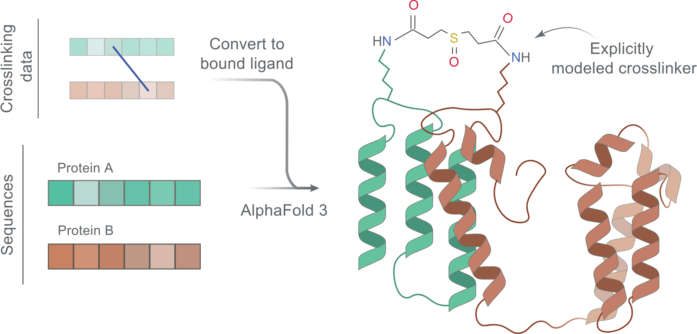

<picture>
  <source srcset="docs/af3x/af3x_scheme.svg" type="image/svg+xml">
  
</picture>

# AF3x: AlphaFold 3 with explicit crosslinks

**[Documentation](https://kosinskilab.github.io/af3x/) | [Preprint](https://www.biorxiv.org/content/10.1101/2024.12.03.626671v4)**

AF3x models chemical crosslinks (XLs) explicitly: each crosslinker is added as a ligand, covalently bonded to both
crosslinked residues. Other XL-based modelling tools use distance restraints between the residues instead.

Research software under active development. AF3x is a fork of AlphaFold 3 and is not affiliated with or endorsed
by Google DeepMind.

**Current version:** `af3x-v0.3.0`, based on AlphaFold 3 v3.0.5 ([all versions](docs/af3x/versions.md)).

This README has two parts: AF3x (this part) and the [original AlphaFold 3 README](#alphafold-3) below it.

## Installation

See [Installing AF3x](docs/af3x/installation.md). AF3x uses the AlphaFold 3 model parameters, which you obtain from
Google (AF3x does not distribute them), and the AlphaFold 3 genetic databases.

## Usage

Add the XLs to an AlphaFold 3 input JSON:

```json
"crosslinks": [
  {"name": "DSSO", "residue_pairs": [[["A", 53], ["B", 66]], [["A", 54], ["B", 113]]]}
]
```

and run `run_alphafold.py` as for AlphaFold 3. Example with a test input:

```sh
python run_alphafold.py \
  --json_path=src/alphafold3/test_data/crosslinks/9G5K/9G5K_input.json \
  --output_dir=output --model_dir=<MODEL_DIR> --norun_data_pipeline
```

Supported crosslinkers: DSSO, DSS, DSG, BS3, BS2G, DSBU, PHOX, BSPEG5, BSPEG9, azide-A-DSBSO, CDI; SDA, LCSDA, SDAD,
SDA25A (NHS ester + diazirine); `LINK<N>`, `RIGID<N>` (generic linkers); disulfide bonds.
Input format and reactive residues: [Crosslink input](docs/af3x/crosslink_input.md); flags and output:
[Running and output](docs/af3x/running.md).

## Documentation

| Page | Content |
|---|---|
| [Crosslink input](docs/af3x/crosslink_input.md) | XL input format, supported XLs, disulfide bonds, adding an XL |
| [Running and output](docs/af3x/running.md) | Command, AF3x flags, seeds, output, checking XLs |
| [Installation](docs/af3x/installation.md) | Requirements, databases, model parameters, install, HMMER |
| [Versions](docs/af3x/versions.md) | AF3x versions, AlphaFold 3 base, reproducibility |
| [FAQ](docs/af3x/faq.md) | Common questions |
| [AlphaFold 3 docs](docs/) | Upstream input format, output, performance, known issues |

## Citing AF3x

If you use AF3x, cite the AF3x preprint
([Improving AlphaFold 3 structural modeling by incorporating explicit crosslinks](https://www.biorxiv.org/content/10.1101/2024.12.03.626671v4))
and AlphaFold 3 ([citation below](#citing-this-work)).

## Licence and terms

AF3x is licensed under the [Apache License 2.0](LICENSE), like the AlphaFold 3 source code it contains.
AF3x additions © 2024–2026 European Molecular Biology Laboratory (EMBL); AlphaFold 3 code © DeepMind Technologies
Limited. AlphaFold 3 files changed for AF3x carry a notice at the top; the changed test data files `src/alphafold3/test_data/featurised_example.json` and
`src/alphafold3/test_data/model_config.json` cannot hold comments. The AlphaFold 3 model parameters and outputs are
subject to the [model parameters terms of use](WEIGHTS_TERMS_OF_USE.md), the
[prohibited use policy](WEIGHTS_PROHIBITED_USE_POLICY.md) and the [output terms of use](OUTPUT_TERMS_OF_USE.md);
AF3x outputs are AlphaFold 3 outputs. The AlphaFold 3 licence and disclaimer below apply.

<br>

---
---

> [!NOTE]
> **End of the AF3x part.** Below is the original AlphaFold 3 README (v3.0.5), unchanged. It describes AlphaFold 3,
> not AF3x: for installing and running AF3x, use the sections above.

---
---

<!-- AF3X: upstream AlphaFold 3 README below, verbatim (check at each sync: diff against `git show <tag>:README.md`). -->


# AlphaFold 3

This package provides an implementation of the inference pipeline of
AlphaFold 3. See below for how to access the model parameters. You may only use
AlphaFold 3 model parameters if received directly from Google. Use is subject to
these
[terms of use](https://github.com/google-deepmind/alphafold3/blob/main/WEIGHTS_TERMS_OF_USE.md).

Any publication that discloses findings arising from using this source code, the
model parameters or outputs produced by those should [cite](#citing-this-work)
the
[Accurate structure prediction of biomolecular interactions with AlphaFold 3](https://doi.org/10.1038/s41586-024-07487-w)
paper.

Please also refer to the Supplementary Information for a detailed description of
the method.

AlphaFold 3 is also available at
[alphafoldserver.com](https://alphafoldserver.com) for non-commercial use,
though with a more limited set of ligands and covalent modifications.

For commercial use, AlphaFold 3 is available via
[Gemini Enterprise Agent Platform on Google Cloud](https://docs.cloud.google.com/gemini-enterprise-agent-platform/models/open-models/alphafold-3).

If you have any questions, please contact the AlphaFold team at
[alphafold@google.com](mailto:alphafold@google.com).

## Obtaining Model Parameters

This repository contains all necessary code for AlphaFold 3 inference. You can
download the AlphaFold 3 model parameters from
https://storage.googleapis.com/alphafold3/af3.bin.zst. Use is subject to these
[terms of use](https://github.com/google-deepmind/alphafold3/blob/main/WEIGHTS_TERMS_OF_USE.md).

The model parameters for the SynthID Bio-structure version of AlphaFold 3, which
predicts watermarked structures, is available at
https://storage.googleapis.com/alphafold3/af3_synthid.bin.zst. See
[google-deepmind/synthidbio](https://github.com/google-deepmind/synthidbio) for
more details.

The model parameters for AlphaFold 3 Leaving Atom (AF3-LA) can be used as an
alternative model fine-tuned for leaving atom handling. The weights are
available at https://storage.googleapis.com/alphafold3/af3_leaving_atom.bin.zst
and are subject to the same terms of use as the original AlphaFold 3 model
parameters. See
[google-deepmind/alphaprotein-novo](https://github.com/google-deepmind/alphaprotein-novo)
for more details.

## Installation and Running Your First Prediction

See the [installation documentation](docs/installation.md).

Once you have installed AlphaFold 3, you can test your setup using e.g. the
following input JSON file named `fold_input.json`:

```json
{
  "name": "2PV7",
  "sequences": [
    {
      "protein": {
        "id": ["A", "B"],
        "sequence": "GMRESYANENQFGFKTINSDIHKIVIVGGYGKLGGLFARYLRASGYPISILDREDWAVAESILANADVVIVSVPINLTLETIERLKPYLTENMLLADLTSVKREPLAKMLEVHTGAVLGLHPMFGADIASMAKQVVVRCDGRFPERYEWLLEQIQIWGAKIYQTNATEHDHNMTYIQALRHFSTFANGLHLSKQPINLANLLALSSPIYRLELAMIGRLFAQDAELYADIIMDKSENLAVIETLKQTYDEALTFFENNDRQGFIDAFHKVRDWFGDYSEQFLKESRQLLQQANDLKQG"
      }
    }
  ],
  "modelSeeds": [1],
  "dialect": "alphafold3",
  "version": 1
}
```

You can then run AlphaFold 3 using the following command:

```
docker run -it \
    --volume $HOME/af_input:/root/af_input \
    --volume $HOME/af_output:/root/af_output \
    --volume <MODEL_PARAMETERS_DIR>:/root/models \
    --volume <DATABASES_DIR>:/root/public_databases \
    --gpus all \
    alphafold3 \
    python run_alphafold.py \
    --json_path=/root/af_input/fold_input.json \
    --model_dir=/root/models \
    --output_dir=/root/af_output
```

There are various flags that you can pass to the `run_alphafold.py` command, to
list them all run `python run_alphafold.py --help`. Two fundamental flags that
control which parts AlphaFold 3 will run are:

*   `--run_data_pipeline` (defaults to `true`): whether to run the data
    pipeline, i.e. genetic and template search. This part is CPU-only, time
    consuming and could be run on a machine without a GPU.
*   `--run_inference` (defaults to `true`): whether to run the inference. This
    part requires a GPU.

## AlphaFold 3 Input

See the [input documentation](docs/input.md).

## AlphaFold 3 Output

See the [output documentation](docs/output.md).

## Performance

See the [performance documentation](docs/performance.md).

## Known Issues

Known issues are documented in the
[known issues documentation](docs/known_issues.md).

Please
[create an issue](https://github.com/google-deepmind/alphafold3/issues/new/choose)
if it is not already listed in [Known Issues](docs/known_issues.md) or in the
[issues tracker](https://github.com/google-deepmind/alphafold3/issues).

## Citing This Work

Any publication that discloses findings arising from using this source code, the
model parameters or outputs produced by those should cite:

```bibtex
@article{Abramson2024,
  author  = {Abramson, Josh and Adler, Jonas and Dunger, Jack and Evans, Richard and Green, Tim and Pritzel, Alexander and Ronneberger, Olaf and Willmore, Lindsay and Ballard, Andrew J. and Bambrick, Joshua and Bodenstein, Sebastian W. and Evans, David A. and Hung, Chia-Chun and O’Neill, Michael and Reiman, David and Tunyasuvunakool, Kathryn and Wu, Zachary and Žemgulytė, Akvilė and Arvaniti, Eirini and Beattie, Charles and Bertolli, Ottavia and Bridgland, Alex and Cherepanov, Alexey and Congreve, Miles and Cowen-Rivers, Alexander I. and Cowie, Andrew and Figurnov, Michael and Fuchs, Fabian B. and Gladman, Hannah and Jain, Rishub and Khan, Yousuf A. and Low, Caroline M. R. and Perlin, Kuba and Potapenko, Anna and Savy, Pascal and Singh, Sukhdeep and Stecula, Adrian and Thillaisundaram, Ashok and Tong, Catherine and Yakneen, Sergei and Zhong, Ellen D. and Zielinski, Michal and Žídek, Augustin and Bapst, Victor and Kohli, Pushmeet and Jaderberg, Max and Hassabis, Demis and Jumper, John M.},
  journal = {Nature},
  title   = {Accurate structure prediction of biomolecular interactions with AlphaFold 3},
  year    = {2024},
  volume  = {630},
  number  = {8016},
  pages   = {493–-500},
  doi     = {10.1038/s41586-024-07487-w}
}
```

## Acknowledgements

AlphaFold 3's release was made possible by the invaluable contributions of the
following people:

Andrew Cowie, Bella Hansen, Charlie Beattie, Chris Jones, Grace Margand,
Jacob Kelly, James Spencer, Josh Abramson, Kathryn Tunyasuvunakool, Kuba Perlin,
Lindsay Willmore, Max Bileschi, Molly Beck, Oleg Kovalevskiy,
Sebastian Bodenstein, Sukhdeep Singh, Tim Green, Toby Sargeant, Uchechi Okereke,
Yotam Doron, and Augustin Žídek (engineering lead).

We also extend our gratitude to our collaborators at Google and Isomorphic Labs.

AlphaFold 3 uses the following separate libraries and packages:

*   [abseil-cpp](https://github.com/abseil/abseil-cpp) and
    [abseil-py](https://github.com/abseil/abseil-py)
*   [Docker](https://www.docker.com)
*   [DSSP](https://github.com/PDB-REDO/dssp)
*   [HMMER Suite](https://github.com/EddyRivasLab/hmmer)
*   [Haiku](https://github.com/deepmind/dm-haiku)
*   [JAX](https://github.com/jax-ml/jax/)
*   [libcifpp](https://github.com/pdb-redo/libcifpp)
*   [NumPy](https://github.com/numpy/numpy)
*   [pybind11](https://github.com/pybind/pybind11) and
    [pybind11_abseil](https://github.com/pybind/pybind11_abseil)
*   [RDKit](https://github.com/rdkit/rdkit)
*   [Tokamax](https://github.com/openxla/tokamax)
*   [tqdm](https://github.com/tqdm/tqdm)

We thank all their contributors and maintainers!

## Get in Touch

If you have any questions not covered in this overview, please contact the
AlphaFold team at alphafold@google.com.

We would love to hear your feedback and understand how AlphaFold 3 has been
useful in your research. Share your stories with us at
[alphafold@google.com](mailto:alphafold@google.com).

For questions surrounding SynthID Bio-structure, please contact
[synthidbio@google.com](mailto:synthidbio@google.com).

## Licence and Disclaimer

This is not an officially supported Google product.

Copyright 2024 DeepMind Technologies Limited.

### AlphaFold 3 Source Code and Model Parameters

AlphaFold 3 source code is licensed under the Apache License, Version 2.0 (the
"License"); you may not use its source code except in compliance with the
License. You may obtain a copy of the License at
http://www.apache.org/licenses/LICENSE-2.0.

The AlphaFold 3 model parameters are made available under the
[AlphaFold 3 Model Parameters Terms of Use](https://github.com/google-deepmind/alphafold3/blob/main/WEIGHTS_TERMS_OF_USE.md)
(the "Terms"); you may not use these except in compliance with the Terms. You
may obtain a copy of the Terms at
[https://github.com/google-deepmind/alphafold3/blob/main/WEIGHTS_TERMS_OF_USE.md](https://github.com/google-deepmind/alphafold3/blob/main/WEIGHTS_TERMS_OF_USE.md).

Unless required by applicable law, AlphaFold 3 and its output are distributed on
an "AS IS" BASIS, WITHOUT WARRANTIES OR CONDITIONS OF ANY KIND, either express
or implied. You are solely responsible for determining the appropriateness of
using AlphaFold 3, or using or distributing its source code or output, and
assume any and all risks associated with such use or distribution and your
exercise of rights and obligations under the relevant terms. Output are
predictions with varying levels of confidence and should be interpreted
carefully. Use discretion before relying on, publishing, downloading or
otherwise using the AlphaFold 3 Assets.

AlphaFold 3 and its output are for theoretical modeling only. They are not
intended, validated, or approved for clinical use. You should not use the
AlphaFold 3 or its output for clinical purposes or rely on them for medical or
other professional advice. Any content regarding those topics is provided for
informational purposes only and is not a substitute for advice from a qualified
professional. See the relevant terms for the specific language governing
permissions and limitations under the terms.

### Third-party Software

Use of the third-party software, libraries or code referred to in the
[Acknowledgements](#acknowledgements) section above may be governed by separate
terms and conditions or license provisions. Your use of the third-party
software, libraries or code is subject to any such terms and you should check
that you can comply with any applicable restrictions or terms and conditions
before use.

### Mirrored and Reference Databases

The following databases have been: (1) mirrored by Google DeepMind; and (2) in
part, included with the inference code package for testing purposes, and are
available with reference to the following:

*   [BFD](https://bfd.mmseqs.com/) (modified), by Steinegger M. and Söding J.,
    modified by Google DeepMind, available under a
    [Creative Commons Attribution 4.0 International License](https://creativecommons.org/licenses/by/4.0/deed.en).
    See the Methods section of the
    [AlphaFold proteome paper](https://www.nature.com/articles/s41586-021-03828-1)
    for details.
*   [PDB](https://wwpdb.org) (unmodified), by H.M. Berman et al., available free
    of all copyright restrictions and made fully and freely available for both
    non-commercial and commercial use under
    [CC0 1.0 Universal (CC0 1.0) Public Domain Dedication](https://creativecommons.org/publicdomain/zero/1.0/).
*   [MGnify: v2022\_05](https://ftp.ebi.ac.uk/pub/databases/metagenomics/peptide_database/2022_05/README.txt)
    (unmodified), by Mitchell AL et al., available free of all copyright
    restrictions and made fully and freely available for both non-commercial and
    commercial use under
    [CC0 1.0 Universal (CC0 1.0) Public Domain Dedication](https://creativecommons.org/publicdomain/zero/1.0/).
*   [UniProt: 2021\_04](https://www.uniprot.org/) (unmodified), by The UniProt
    Consortium, available under a
    [Creative Commons Attribution 4.0 International License](https://creativecommons.org/licenses/by/4.0/deed.en).
*   [UniRef90: 2022\_05](https://www.uniprot.org/) (unmodified) by The UniProt
    Consortium, available under a
    [Creative Commons Attribution 4.0 International License](https://creativecommons.org/licenses/by/4.0/deed.en).
*   [NT: 2023\_02\_23](https://www.ncbi.nlm.nih.gov/nucleotide/) (modified) See
    the Supplementary Information of the
    [AlphaFold 3 paper](https://nature.com/articles/s41586-024-07487-w) for
    details.
*   [RFam: 14\_4](https://rfam.org/) (modified), by I. Kalvari et al., available
    free of all copyright restrictions and made fully and freely available for
    both non-commercial and commercial use under
    [CC0 1.0 Universal (CC0 1.0) Public Domain Dedication](https://creativecommons.org/publicdomain/zero/1.0/).
    See the Supplementary Information of the
    [AlphaFold 3 paper](https://nature.com/articles/s41586-024-07487-w) for
    details.
*   [RNACentral: 21\_0](https://rnacentral.org/) (modified), by The RNAcentral
    Consortium available free of all copyright restrictions and made fully and
    freely available for both non-commercial and commercial use under
    [CC0 1.0 Universal (CC0 1.0) Public Domain Dedication](https://creativecommons.org/publicdomain/zero/1.0/).
    See the Supplementary Information of the
    [AlphaFold 3 paper](https://nature.com/articles/s41586-024-07487-w) for
    details.
