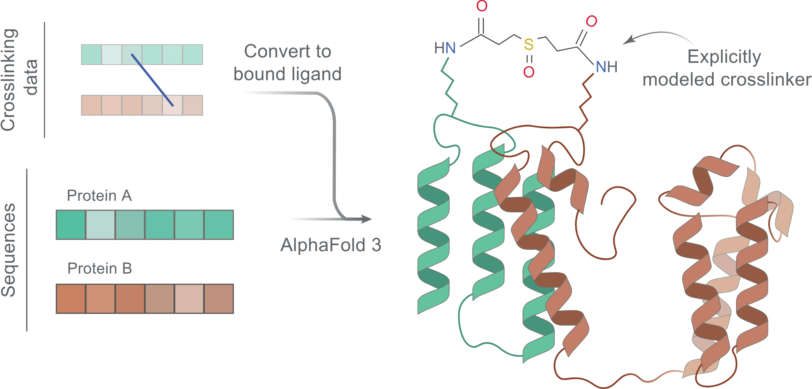

<picture>
  <source srcset="af3x/af3x_scheme.svg" type="image/svg+xml">
  
</picture>

# AF3x

AlphaFold 3 with explicit crosslinks (XLs): each crosslinker becomes a ligand chain, covalently bonded to both
crosslinked residues. You list the XLs in an AlphaFold 3 input JSON; AF3x adds the crosslinker ligands when you run
it.

Current version: `af3x-v0.3.0`, based on AlphaFold 3 v3.0.5.

AF3x is a fork of AlphaFold 3 and is not affiliated with or endorsed by Google DeepMind.

| Page | Content |
|---|---|
| [Installation](af3x/installation.md) | Requirements, databases, model parameters, install |
| [Crosslink input](af3x/crosslink_input.md) | Input format, supported crosslinkers, disulfide bonds. Or build the input in the browser with the [input generator](https://kosinskilab.github.io/af3x-input-generator/) |
| [Running and output](af3x/running.md) | Command, AF3x flags, seeds, output, checking crosslinks |
| [Versions](af3x/versions.md) | AF3x versions and reproducibility |
| [FAQ](af3x/faq.md) | Common questions |
| [AlphaFold 3 documentation](installation.md) | Upstream pages (v3.0.5) |

Source code: [KosinskiLab/af3x](https://github.com/KosinskiLab/af3x). Preprint:
[Improving AlphaFold 3 structural modeling by incorporating explicit crosslinks](https://www.biorxiv.org/content/10.1101/2024.12.03.626671v2).
